<p align="center">
  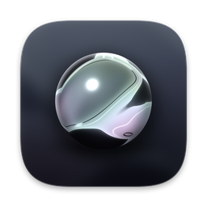
</p>

<h1 align="center">DotStudio</h1>

<p align="center">
  Living screensavers and wallpaper for your Mac: generative scenes, real clocks,<br>
  live skies, and the song you're playing on top.<br>
  <a href="https://dotstudio.davidlam.online"><b>dotstudio.davidlam.online</b></a> ·
  <a href="https://github.com/dw2lam/DotStudio/releases/latest/download/DotStudio.dmg">Download</a>
</p>

<p align="center">
  <a href="https://github.com/dw2lam/DotStudio/releases/latest"></a>
  
  
  
</p>

<p align="center">
  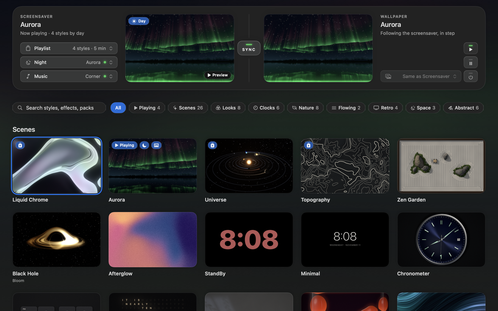
</p>

Pick from the gallery or build your own in a live editor. DotStudio installs one screensaver,
then everything — which style plays, at night, in rotation, behind your windows — happens in
the app. Native, local, free.

## Features

- **Scenes and Looks.** Scenes paint themselves — Liquid Chrome, Topography, Zen Garden, a 3D
  solar system, a black hole. Looks restyle your own photos and video (or the built-in
  public-domain slideshow): film, riso, cyanotype, dithers, ASCII, CRT.
- **Clocks.** StandBy, Minimal and Chronometer are new in 1.4.2, alongside Flip Clock,
  Word Clock and Window Light.
- **Bounce.** A logo drifts corner to corner, changing colour on every bounce, and every couple
  of minutes lands exactly in a corner. Use the DotStudio mark, a word, or your own logo.
- **Live skies.** Tidewater follows the real sun and moon; the sea scenes follow your local
  weather — cloud, rain, storms, fog and snow.
- **What's playing.** Spotify or Apple Music over any screensaver — in a corner, or full screen
  in Album, Stage or Cover layouts over the album's living art.
- **Live wallpaper with SYNC.** Any style behind your windows, or press SYNC and the desktop plays
  the screensaver's scene in step, so the screensaver starts right where your desktop was.
- **Playlist and Night.** One style, a rotation, and another look after your real sunset.
- **In the menu bar.** Music, wallpaper and styles without opening a window.
- **Instant start.** The screensaver is up the moment your Mac goes idle.
- **Efficient.** Every scene draws with its own GPU pipeline; the wallpaper pauses when windows
  cover it, and frame rate caps on battery. 120 fps on ProMotion displays, when you want it.
- **Updates itself.** New versions arrive from GitHub Releases and install when you quit.
- **Private.** Your library stays on your Mac. Weather is fetched for your approximate location,
  rounded to about 10 km. When a player doesn't hand over a cover, DotStudio looks it up in
  Spotify's or Apple's public catalog — only the song's ID, or its artist and album, is sent.

## Gallery

Every frame here is rendered by the app.

| | | |
|:--:|:--:|:--:|
| 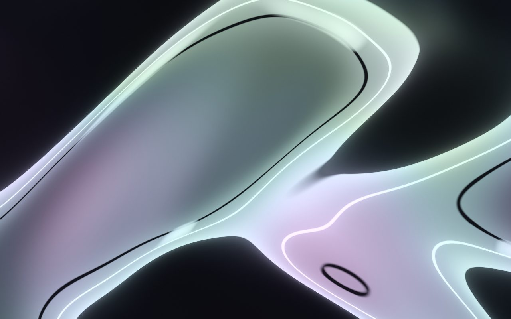<br>**Liquid Chrome** | 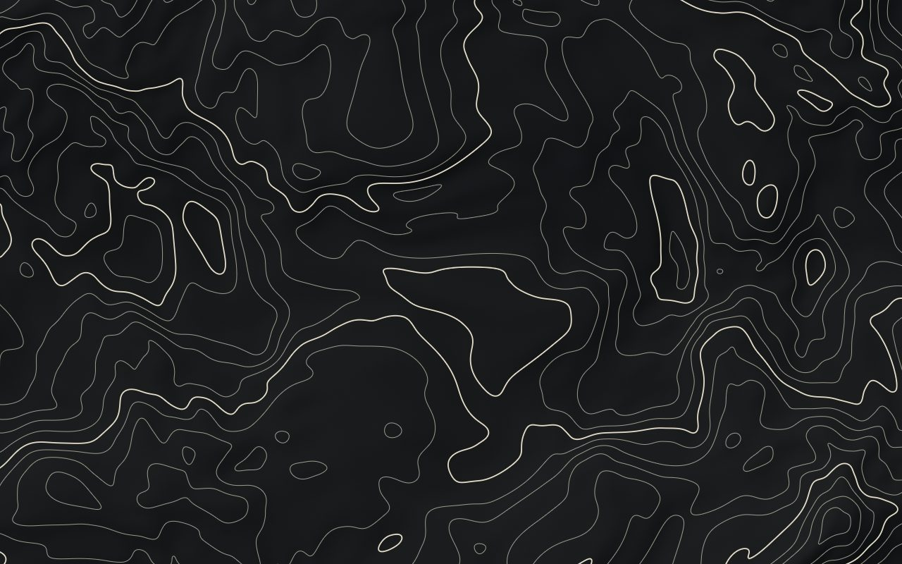<br>**Topography** | 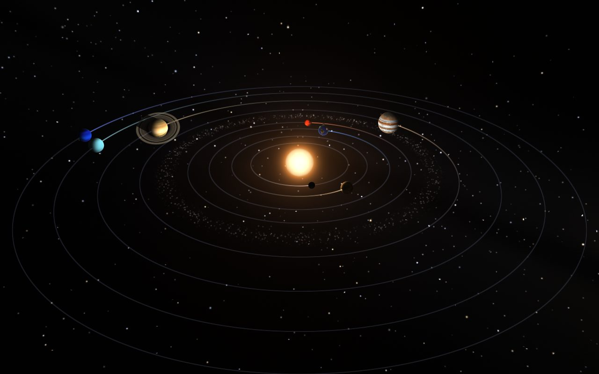<br>**Universe** |
| 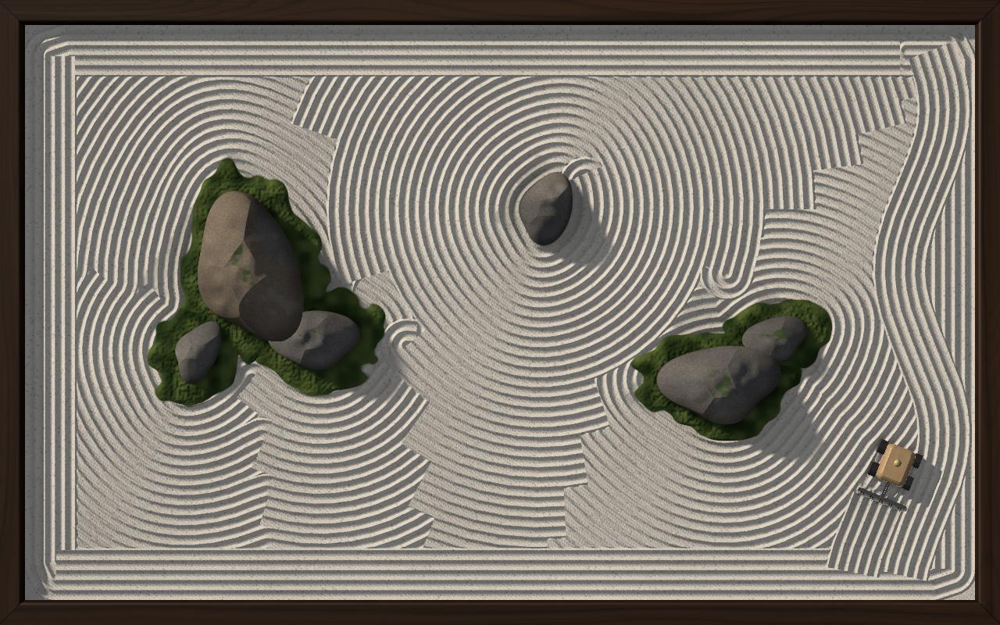<br>**Zen Garden** | 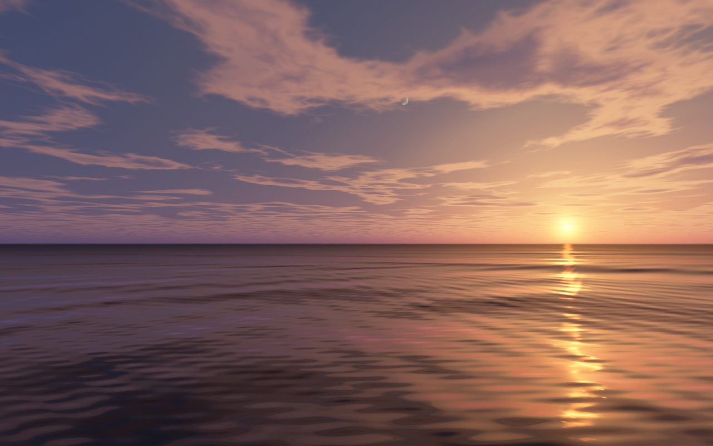<br>**Tidewater** | 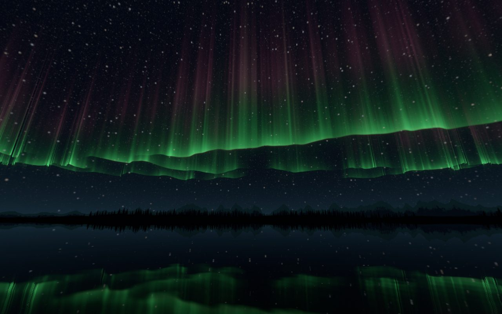<br>**Aurora** |
| 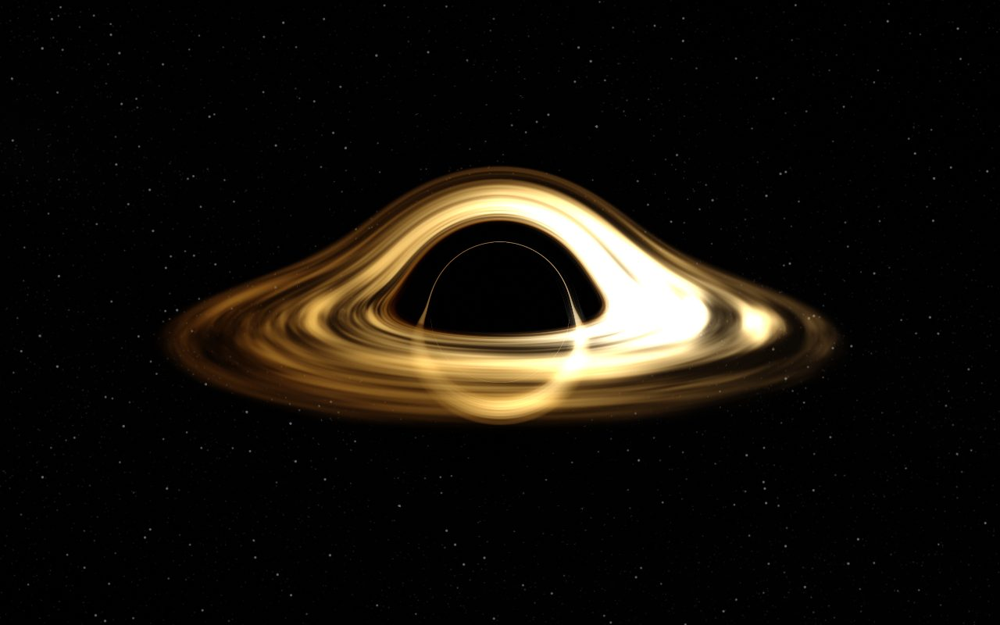<br>**Black Hole** | 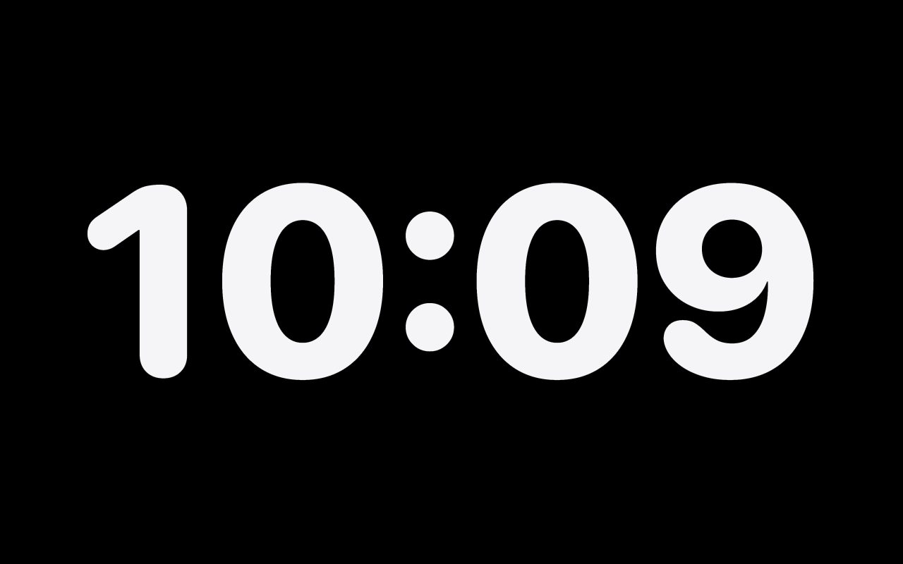<br>**StandBy** | 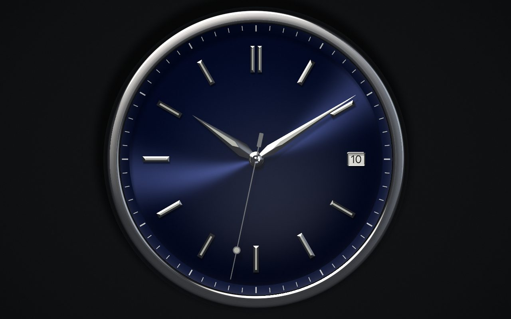<br>**Chronometer** |
| 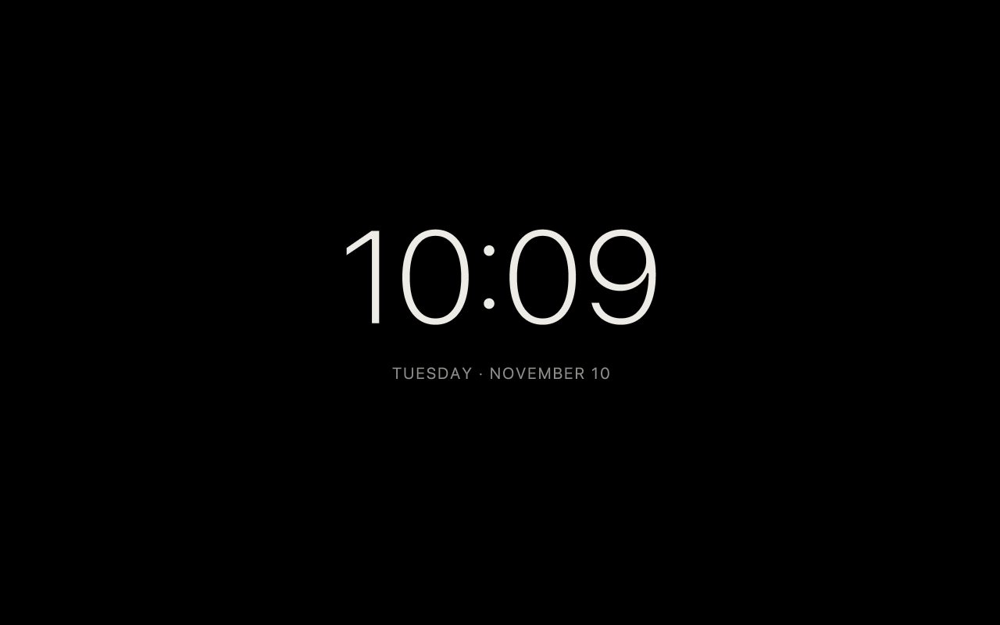<br>**Minimal** | 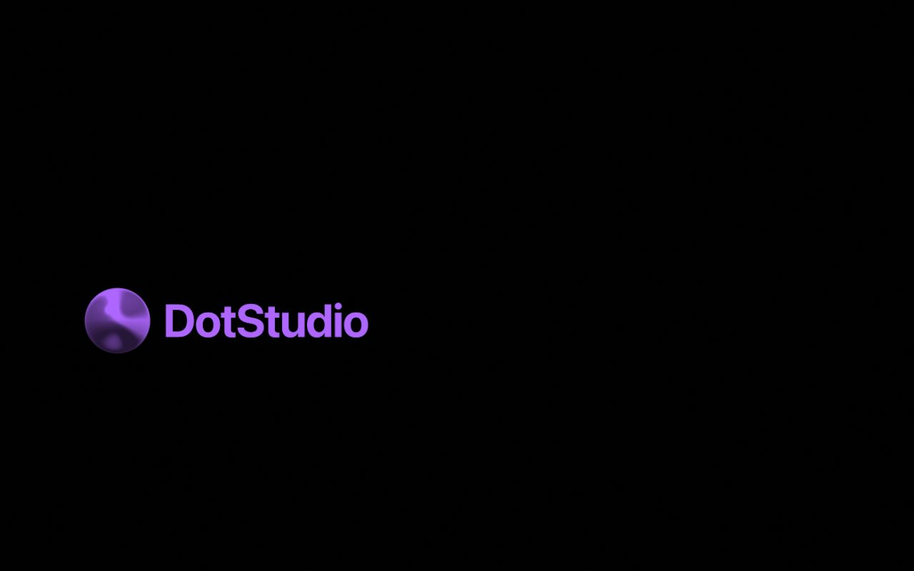<br>**Bounce** | 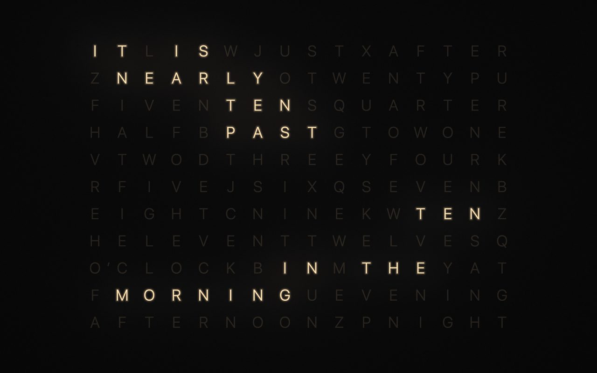<br>**Word Clock** |

### What's playing

| | |
|:--:|:--:|
| 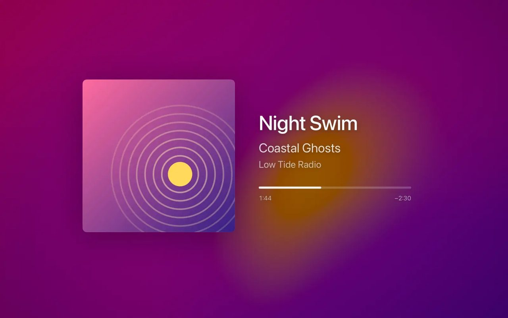<br>**Full Screen** · Album | 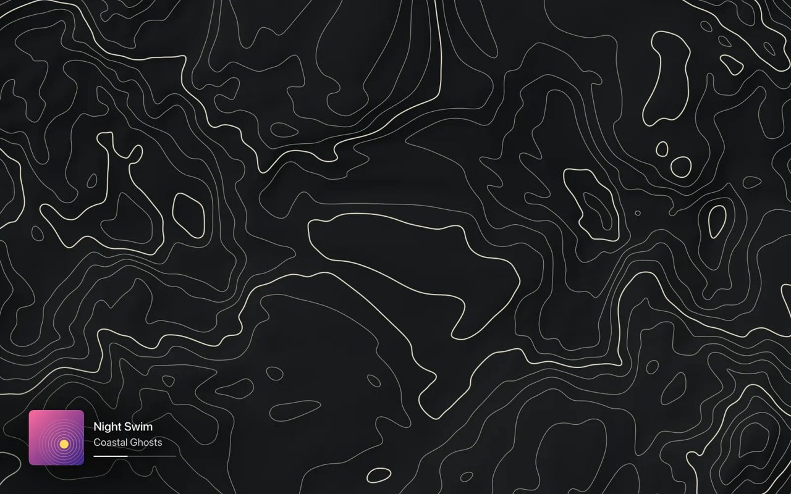<br>**Corner** · over Topography |

<sub>Demo track and artwork.</sub>

### The editor

Double-click any tile. A big live preview beside every dial — angle, speed, colour, frame rate.
Stack effects on top of a scene, or start from nothing with **Create Your Own**.

<p align="center">
  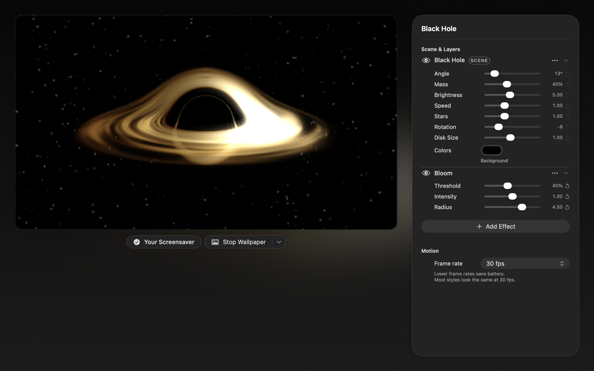
</p>

## Install

1. Download **[DotStudio.dmg](https://github.com/dw2lam/DotStudio/releases/latest/download/DotStudio.dmg)**
   from the [latest release](https://github.com/dw2lam/DotStudio/releases/latest) and drag
   **DotStudio** into Applications.
2. Open it once. DotStudio isn't notarized yet, so macOS stops the first launch: go to
   **System Settings → Privacy & Security** and click **Open Anyway**.
3. Follow the welcome guide. It installs the screensaver, then shows you where to choose it in
   **Wallpaper → Screen Saver**. After that, you switch styles inside the app.

Updates are automatic: DotStudio checks GitHub Releases, downloads new versions in the background
and installs them when you quit (or **Settings → Updates → Restart to Update**). The screensaver
updates along with the app. Releases are signed with a stable identity, so privacy permissions
(like Automation for Spotify and Music) survive updates.

Requires macOS 14 or later. Made and tested on Apple Silicon.

### Build from source

Needs Xcode 26 or later (the app uses the macOS 26 SDK) and [XcodeGen](https://github.com/yonaskolb/XcodeGen).

```bash
brew install xcodegen
git clone https://github.com/dw2lam/DotStudio.git && cd DotStudio
xcodegen generate
xcodebuild -project DotStudio.xcodeproj -scheme DotStudio -configuration Release \
  -derivedDataPath build build
open build/Build/Products/Release
```

If the first build asks for the Metal toolchain: `xcodebuild -downloadComponent MetalToolchain`.

## How it works

- **One screensaver.** The app embeds a single universal `DotStudio.saver`. It reads the shared
  library in `~/Library/Application Support/DotStudio` (read-only, from the sandboxed screensaver
  host) and plays whatever the library says. The app writes the library, plus the music and
  weather state the screensaver shows. Switching styles never touches System Settings.
- **A pipeline per scene.** Each scene is compiled into its own Metal pipeline, and after an
  install or update the app precompiles them for your Mac into a pipeline archive, so the
  screensaver draws its first frame almost immediately.
- **Wallpaper.** Desktop-level windows paced to the display. They stop drawing entirely while
  covered, locked, asleep or under the screensaver, and hold still when the Mac runs hot.

## Development

Headless tools — nothing is shown on screen, and each one runs against a throwaway store
(`DOTSTUDIO_STORE_DIR=$(mktemp -d)`), never your real library.

| Tool | What it does |
|---|---|
| `tools/gallery/render.sh <dir> --only "Aurora" --size 1280x800` | Renders the default styles to PNGs (`--clock`, `--weather`, `--logo`, music flags; see `main.swift`) |
| `tools/perf/run.sh renderer\|saver\|wallpaper\|idle` | CPU, allocation, file-system and wake-up costs of the render loops |
| `tools/startup/run.sh` | Time to first frame, cold and warm |
| `tools/music-selftest/run.sh` | End-to-end music detection, driven by synthetic player notifications |
| `tools/icon/build.sh <dir>` | Regenerates the app icon from the renderer |
| `DOTSTUDIO_UI_SHOTS=<dir>` on the app binary | Off-screen renders of every app screen (`DOTSTUDIO_UI_ONLY`, `_SIZES`, `_APPEARANCE`; see `App/Shots.swift`) |

Release history is in [CHANGELOG.md](CHANGELOG.md). Tagging `v*` builds, signs and publishes a
release with its Sparkle appcast (`.github/workflows/release.yml`).

## Credits

Built with SwiftUI and Metal. Updates by [Sparkle](https://sparkle-project.org).

- Weather: [Weather data by Open-Meteo.com](https://open-meteo.com/), licensed
  [CC BY 4.0](https://creativecommons.org/licenses/by/4.0/).
- Earth and planet maps in **Universe**: [Solar System Scope](https://www.solarsystemscope.com/textures/),
  licensed [CC BY 4.0](https://creativecommons.org/licenses/by/4.0/).
- Built-in slideshow photos: CC0 and public domain, via Wikimedia Commons — see
  [Shared/Photos/CREDITS.md](Shared/Photos/CREDITS.md).
- The Looks were inspired by [grain.rad](https://grainrad.com) and [ditherit.com](https://ditherit.com).
