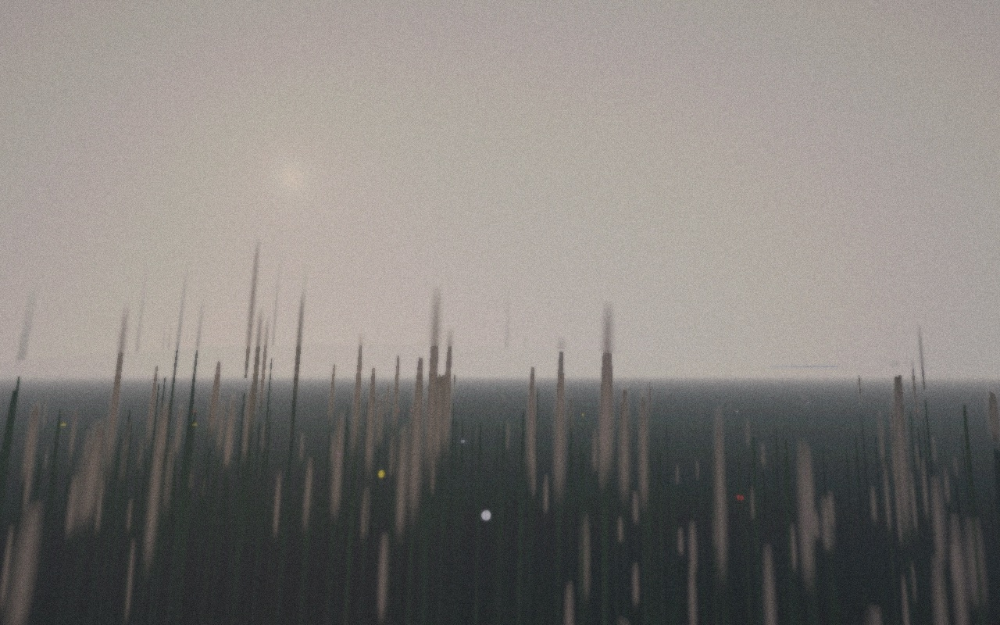

# Match my wallpaper

> **You:** Match my wallpaper — it's a foggy pine forest in the morning, all teal-grey and soft.

```
→ get_started({})
```
```text
DotStudio makes calm, living screensavers and live wallpapers for the Mac. A STYLE is a named stack of effects: a SCENE first (it draws its own image: ocean, meadow, clocks, liquid chrome, bloom…), then 0–2 LOOKS that restyle it (halftone, riso, glass, grain…). A stack of looks alone restyles the sh …
```

**Assistant:** Fog, early light, muted greens: Meadow's landscapes do weather and time of day, so I'll take Tall Grass at dawn in fog, almost no flowers and a still wind, with a light grain wash so it sits with the photo.

```
→ create_style({"name": "Morning Fog", "fps": 24, "effects": [{"kind": "meadow", "params": {"live": false, "hour": 6.5, "weather": "Fog", "landscape": "Tall Grass", "flowers": 0.05, "wind": 0.2, "speed": 0.6}, "colorA": {"r": 0.22, "g": 0.34, "b": 0.3}, "colorB": {"r": 0.72, "g": 0.76, "b": 0.74}}, {"kind": "grainWash", "params": {"soft": 0.2, "grain": 0.06, "tint": 0.1}}]})
```
```text
Created “Morning Fog” (23EE7B68-7781-4701-ADAE-3AD2D422AC6C). DotStudio isn't running: library.json was updated; the app shows it next time it opens.
Next: preview_style(style: "23EE7B68-7781-4701-ADAE-3AD2D422AC6C") — and a contact sheet over time (frames: 6) to check the motion.
```

```
→ preview_style({"style": "23EE7B68-7781-4701-ADAE-3AD2D422AC6C", "t": 12, "width": 1280, "height": 800})
```
```text
“Morning Fog” at t = 12.0 s.
```



```
→ benchmark_style({"style": "23EE7B68-7781-4701-ADAE-3AD2D422AC6C"})
```
```text
“Morning Fog” at 5120×2880 on Apple M5 Pro: 12.74 ms min, 14.15 ms median GPU per frame (≈71 fps of GPU headroom). Too heavy for a screensaver: simplify (fewer looks, lower detail/octave params) or lower fps.
```

Resulting style (as stored in `library.json`):

```json
{
  "effects": [
    {
      "colorA": {
        "r": 0.22,
        "b": 0.3,
        "g": 0.34,
        "a": 1
      },
      "id": "481A8986-A039-44D6-B411-9F83382CF147",
      "colorB": {
        "r": 0.72,
        "b": 0.74,
        "g": 0.76,
        "a": 1
      },
      "enabled": true,
      "kind": "meadow",
      "params": {
        "clouds": 0.5,
        "dither": 0.5,
        "glow": 0.5,
        "hour": 6.5,
        "lapse": 0,
        "live": 0,
        "speed": 0.6,
        "wind": 0.2,
        "weather": 4,
        "landscape": 2,
        "flowers": 0.05
      }
    },
    {
      "colorA": {
        "r": 0.12,
        "b": 0.24,
        "g": 0.08,
        "a": 1
      },
      "id": "EC7F242A-9776-4AD4-9701-66D37012B30A",
      "colorB": {
        "r": 1,
        "b": 0.64,
        "g": 0.8,
        "a": 1
      },
      "enabled": true,
      "kind": "grainWash",
      "params": {
        "soft": 0.2,
        "paper": 0,
        "tint": 0.1,
        "grain": 0.06,
        "halation": 0
      }
    }
  ],
  "id": "23EE7B68-7781-4701-ADAE-3AD2D422AC6C",
  "fps": 24,
  "name": "Morning Fog"
}
```
