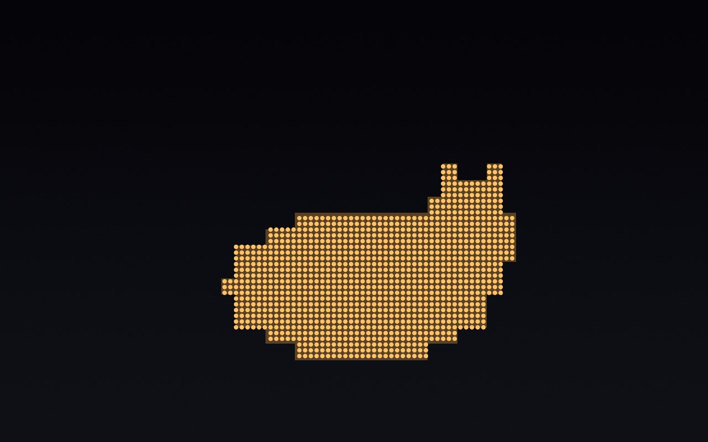

# A pixel cat on an LED panel (custom scene, cells engine)

> **You:** Make a little pixel cat sleeping on an LED panel, like the penguin one.

```
→ list_engines({})
```
```text
- cells v1 (cells), built in
- film v1 (film), built in
- metal v1 (metal-source), built in
```

```
→ read_guide({"id": "engines/cells"})
```
```text
# The `cells` engine (v1)

The CellKit look of DotStudio's Bloom scene: your scene, sampled once per cell, drawn as
**LED dots**, **rounded LED pixels** or **glyphs** (△ ▽ C Z O ☆ · ( )) over a soft glow of its
own light. Built on the `metal` engine — read its guide first; everything in `DotStudio.h` works.

```metal
#include <DotStudio.h>

float4 dsScene(float2 uv, DSContext ctx) {
    float2 p = …
```

```
→ create_custom_scene({"manifest": {"name": "Sleepy Cat", "engine": {"id": "cells", "version": ">=1"}, "fps": 24, "stepped": true, "licence": "own work", "params": [{"key": "breath", "label": "Breathing", "kind": "slider", "min": 0, "max": 1, "default": 0.5}, {"key": "zzz", "label": "Zzz", "kind": "toggle", "default": 1}], "colors": {"a": {"label": "Panel", "default": [0.02, 0.02, 0.03, 1]}, "b": {"label": "Cat", "default": [0.98, 0.72, 0.38, 1]}}, "uses": [], "description": "A pixel cat asleep on a dark LED panel.", "guides": ["style/dotstudio"]}, "source": "…below…"})
```
`source`:

```metal
#include <DotStudio.h>
// A sleeping cat, 24×14 cells, breathing slowly; one z drifts up every ~9 s.
float4 dsScene(float2 uv, DSContext ctx) {
    float2 g = floor(uv * float2(48, 27));                 // cell grid
    float breathe = 0.5 + 0.5 * sin(ctx.t * 0.7);          // slow, never a hard loop with the z below
    float2 c = g - float2(24, 9);
    float body = step(length(c / float2(9, 4.5 + breathe * 0.4)), 1.0) * step(-4.0, c.y);
    float head = step(length((c - float2(7, 3)) / 3.2), 1.0);
    float ears = step(abs(c.x - 6) + abs(c.y - 6.5), 1.2) + step(abs(c.x - 9) + abs(c.y - 6.5), 1.2);
    float cat = saturate(body + head + ears);
    float zt = fract(ctx.t / 9.0);
    float2 zp = float2(31 + zt * 3, 13 + zt * 6);
    float z = step(abs(g.x - zp.x) + abs(g.y - zp.y), 0.6) * (1 - zt) * ctx.p[1];
    float3 col = mix(ctx.colorA.rgb, ctx.colorB.rgb, cat) + z * 0.6;
    return float4(col, max(cat, z));                       // colour + coverage: the engine lights cells
}
```
```text
Compiles.
GPU ≈ 0.94 ms per frame at 5K.
Installed as sleepy-cat-a225ed54. Use it: create_style(effects: [{"kind": "custom", "scene": "sleepy-cat-a225ed54"}]).
```

```
→ create_style({"name": "Sleepy Cat", "fps": 24, "effects": [{"kind": "custom", "scene": "sleepy-cat-a225ed54", "params": {"zzz": true, "ds.render": "Dots"}}]})
```
```text
Created “Sleepy Cat” (3A1BA0F9-D598-4474-971C-48322D42E410). DotStudio isn't running: library.json was updated; the app shows it next time it opens.
Next: preview_style(style: "3A1BA0F9-D598-4474-971C-48322D42E410") — and a contact sheet over time (frames: 6) to check the motion.
```

```
→ preview_style({"style": "3A1BA0F9-D598-4474-971C-48322D42E410", "t": 4, "width": 1280, "height": 800})
```
```text
“Sleepy Cat” at t = 4.0 s.
```



```
→ benchmark_style({"style": "3A1BA0F9-D598-4474-971C-48322D42E410"})
```
```text
“Sleepy Cat” at 5120×2880 on Apple M5 Pro: 0.76 ms min, 1.05 ms median GPU per frame (≈956 fps of GPU headroom). Within budget.
```

Resulting style (as stored in `library.json`):

```json
{
  "effects": [
    {
      "colorA": {
        "r": 0.02,
        "b": 0.03,
        "g": 0.02,
        "a": 1
      },
      "colorB": {
        "r": 0.98,
        "b": 0.38,
        "g": 0.72,
        "a": 1
      },
      "custom": {
        "id": "sleepy-cat-a225ed54"
      },
      "enabled": true,
      "id": "AC31C8D6-E48A-4395-ACFE-9248012BB61A",
      "params": {
        "breath": 0.5,
        "ds.render": 2,
        "zzz": 1
      },
      "kind": "custom"
    }
  ],
  "id": "3A1BA0F9-D598-4474-971C-48322D42E410",
  "fps": 24,
  "name": "Sleepy Cat"
}
```
